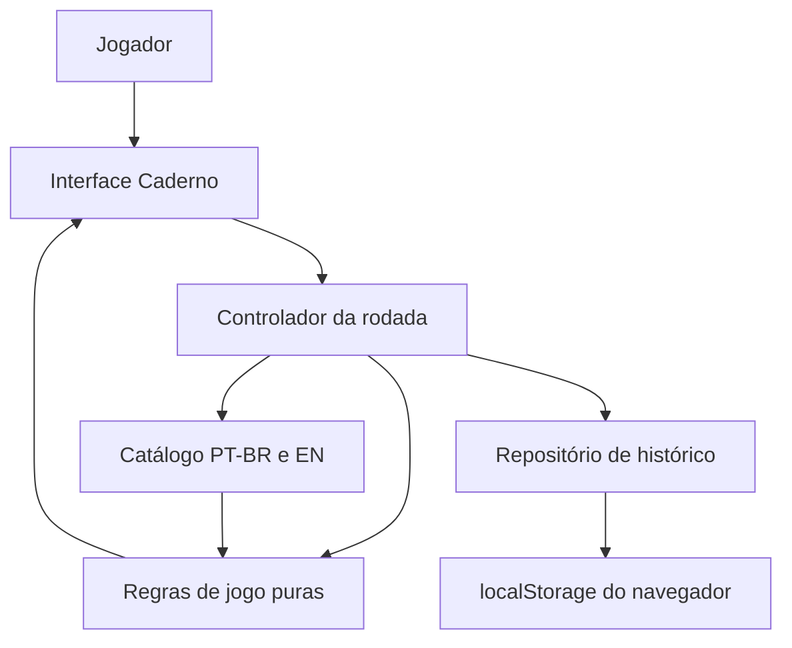
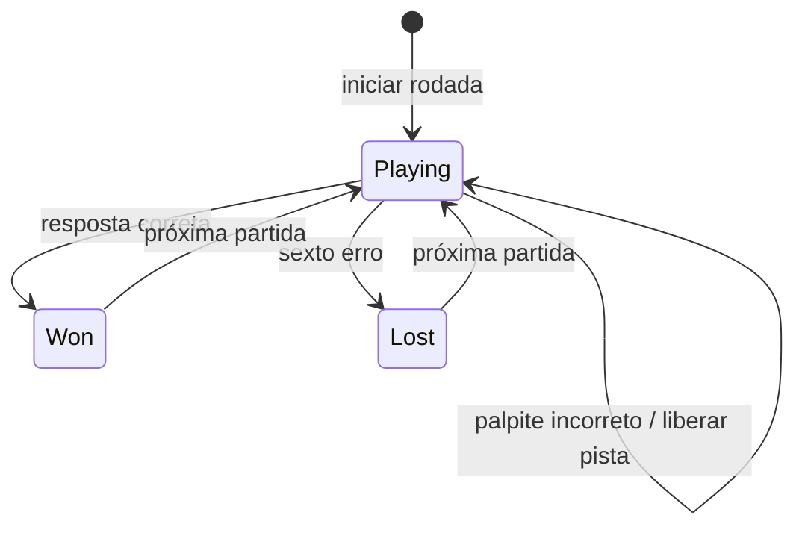

# Documento de Projeto Técnico

**Produto:** Jogo de Adivinhação de Palavras  
**Versão do documento:** 0.1  
**Estado:** Proposta técnica para o MVP  
**Documento de produto relacionado:** [PRD.md](PRD.md)  
**Protótipo visual relacionado:** [index.html](index.html)

## 1. Resumo executivo

Implementar um jogo casual de adivinhação de palavras para navegador, com suporte a português e inglês, até seis palpites por rodada, pistas graduais, definição ao final e histórico mantido localmente. A experiência de produção seguirá a direção visual **Caderno**, que é o conceito inicial selecionado no protótipo: tipografia editorial, área central para palavra e pistas e uma régua lateral de tentativas.

A recomendação é uma aplicação cliente-side sem conta, API, banco remoto, anúncios ou telemetria. Para o MVP, usar TypeScript, Vite, HTML semântico e CSS próprio. O protótipo atual é um HTML interativo autocontido; a implementação de produção deve separar regras, conteúdo, persistência e componentes de interface para facilitar testes e manutenção.

## 2. Premissas e decisões

O PRD ainda deixa algumas regras em aberto. Para que a implementação possa avançar, este documento usa as seguintes **propostas**, que devem ser confirmadas antes de congelar o escopo:

| Tema | Proposta técnica para o MVP | Situação |
|---|---|---|
| Direção visual | Caderno como única interface de produção; Arcade e Oficina permanecem conceitos de exploração | Assumido pelo conceito inicialmente ativo |
| Progressão das pistas | Mostrar a primeira pista no início e liberar uma pista adicional após cada palpite incorreto | Precisa de confirmação de produto |
| Idioma | PT-BR por padrão; seletor PT/EN escolhe o idioma da próxima rodada | Precisa de confirmação de produto |
| Palpite aceito | Até a decisão sobre dicionário, qualquer texto não vazio é um palpite e consome uma tentativa | Precisa de confirmação de produto |
| Repetição | Não selecionar palavra já jogada no mesmo navegador enquanto houver palavra inédita daquele idioma | Está no PRD |
| Fim do banco | Preservar histórico e oferecer reinício explícito do ciclo de palavras, sem apagar partidas antigas | Precisa de confirmação de produto |
| Dados | Persistência local no navegador, sem sincronização ou conta | Está no PRD |
| Fontes | Usar fontes licenciadas e empacotadas com a aplicação, sem requisição a um provedor externo | Recomendação técnica |

Os resultados do protótipo devem ser considerados demonstração de fluxo, não decisão implícita, especialmente para idioma, aceitação de palavras e exaustão do conteúdo.

## 3. Escopo técnico do MVP

### Incluído

- Aplicação de página única, responsiva, distribuída como arquivos estáticos.
- Interface Caderno em português e inglês.
- Rodada com palavra-alvo de pelo menos seis letras e até seis palpites.
- Comparação da resposta sem diferenciar maiúsculas/minúsculas ou diacríticos.
- Revelação progressiva de pistas, conforme regra aprovada.
- Estado de vitória e derrota com palavra e definição.
- Histórico de partidas concluídas, incluindo palpites e pistas apresentadas.
- Seleção que evita repetir palavras já jogadas, por idioma e navegador.
- Funcionalidade de apagar o histórico, com confirmação.
- Uso por teclado, leitor de tela e viewport móvel conforme requisitos deste documento.

### Não incluído

- Backend, cadastro, sincronização entre aparelhos ou serviço de conta.
- Multiplayer, ranking, compartilhamento social ou recursos competitivos.
- Anúncios, compra, assinatura ou analytics.
- Dificuldades selecionáveis.
- Geração automática de pistas ou respostas por IA.

## 4. Arquitetura proposta

A arquitetura separa a interface da lógica de domínio e do armazenamento local. As regras centrais devem ser funções puras, sem dependência do DOM ou do navegador, para permitir testes determinísticos.



### Stack

- **TypeScript** para estado, modelos, regras e persistência.
- **Vite** para desenvolvimento local e geração de arquivos estáticos.
- **HTML semântico e CSS** para a interface; não há necessidade inicial de framework de componentes.
- **Vitest** para testes unitários das regras e validação do catálogo.
- **Playwright** para testes de fluxo em navegador e viewports móveis.
- **axe-core**, opcional no teste E2E, como verificação automatizada complementar de acessibilidade.

O projeto não exige servidor de aplicação. O artefato de produção (`dist/`) pode ser publicado em hospedagem estática HTTPS. Não deve haver requisições de runtime para APIs, analytics, publicidade ou fontes externas.

### Estrutura sugerida

```text
src/
  main.ts
  app/
    createApp.ts
    gameController.ts
  domain/
    game.ts
    gameRules.ts
    normalizeGuess.ts
    selectNextWord.ts
  content/
    words.pt-BR.json
    words.en.json
    validateCatalog.ts
  persistence/
    historyRepository.ts
    historySchema.ts
  ui/
    AppShell.ts
    GameScreen.ts
    LanguageSelector.ts
    AttemptRail.ts
    ClueList.ts
    GuessForm.ts
    GuessHistory.ts
    ResultPanel.ts
    HistoryDialog.ts
  styles/
    tokens.css
    base.css
    game.css
    responsive.css
  assets/
    fonts/
tests/
  unit/
  e2e/
```

A estrutura é uma proposta inicial. Não transformar cada elemento visual em componente independente se isso não reduzir complexidade; a separação importante é entre domínio, UI, catálogo e persistência.

## 5. Modelo de domínio

Exemplo conceitual dos tipos. Os nomes são propostos em inglês para consistência com APIs e tooling; a interface permanece em português/inglês conforme o idioma da rodada.

```ts
type Language = "pt-BR" | "en";
type GameStatus = "playing" | "won" | "lost";

interface WordEntry {
  id: string;
  answer: string;
  language: Language;
  definition: string;
  clues: string[];
  sourceRef: string;
  status: "draft" | "published";
}

interface GuessRecord {
  value: string;
  normalizedValue: string;
  submittedAt: string;
  correct: boolean;
}

interface GameState {
  wordId: string;
  language: Language;
  status: GameStatus;
  guesses: GuessRecord[];
  revealedClueCount: number;
  startedAt: string;
  completedAt?: string;
}

interface CompletedGame {
  schemaVersion: 1;
  gameId: string;
  wordId: string;
  answerSnapshot: string;
  language: Language;
  definitionSnapshot: string;
  cluesShown: string[];
  guesses: GuessRecord[];
  outcome: "won" | "lost";
  completedAt: string;
}
```

`answerSnapshot`, `definitionSnapshot` e `cluesShown` preservam o que a pessoa viu mesmo se uma entrada editorial for alterada no futuro. Não guardar dados pessoais: não há necessidade de nome, e-mail, identificador de publicidade ou localização.

## 6. Regras de jogo e transições

### Início da rodada

1. Receber o idioma escolhido para a próxima rodada.
2. Carregar as palavras publicadas e elegíveis daquele idioma.
3. Excluir IDs presentes no histórico local daquele idioma.
4. Escolher uma palavra inédita de forma aleatória entre as elegíveis.
5. Inicializar `status = "playing"`, zero palpites e uma pista revelada.

A escolha aleatória deve ser injetável nos testes para que a sequência possa ser determinística. Não usar `Math.random()` diretamente dentro da regra de domínio.

### Envio de palpite

1. Remover espaços no início e no fim; normalizar Unicode e caixa para comparação.
2. Rejeitar vazio sem consumir tentativa.
3. Comparar o palpite normalizado com a resposta normalizada.
4. Se correto, encerrar como vitória e salvar uma entrada no histórico.
5. Se incorreto, acrescentar um palpite, revelar a próxima pista disponível e continuar.
6. Ao atingir seis palpites incorretos, encerrar como derrota, revelar resposta e definição e salvar no histórico.
7. Impedir envio adicional após o estado terminal.

A normalização proposta é `NFC` para armazenamento e comparação sem diacríticos, com minúsculas locais ao idioma. A forma original digitada e a resposta editorial devem ser preservadas para exibição. Assim, `pessego` pode corresponder a `pêssego`; não se deve remover caracteres ou pontuação indiscriminadamente além do que for aprovado como regra linguística.

### Máquina de estados



O caso de palpite repetido ainda não está definido pelo PRD. Recomendação: detectar repetição após normalização e informar que a palavra já foi tentada, sem consumir uma tentativa. Se essa regra for aceita, deve existir teste específico.

## 7. Catálogo de palavras

O catálogo inicial será mantido em arquivos JSON versionados junto ao código. Cada item precisa ter uma resposta, idioma, definição, pistas ordenadas e referência de origem/licença. Um script de validação deve falhar no build quando encontrar:

- ID duplicado ou campo obrigatório ausente.
- Palavra com menos de seis letras após normalização Unicode.
- Menos de uma pista ou definição vazia.
- Resposta conjugada, nome próprio ou forma regional não aprovada editorialmente.
- Duplicata normalizada dentro do mesmo idioma.
- Origem/licença não registrada.

Validações automáticas não identificam com segurança conjugações, qualidade da definição ou adequação etária. Esses critérios exigem revisão humana. PT-BR e inglês devem ter curadoria separada; as pistas e definições precisam estar escritas no idioma da resposta.

O banco é finito. Ao esgotá-lo, não fingir que ainda há palavras inéditas: informar que o ciclo terminou e oferecer uma ação explícita para jogar novamente com o catálogo existente. Essa ação deve preservar o histórico, a menos que a pessoa escolha apagá-lo.

## 8. Persistência local

Criar uma interface `HistoryRepository` com operações como `listCompletedGames()`, `addCompletedGame(game)` e `clear()`. A implementação inicial usa `localStorage`, por exemplo com a chave `word-game.history.v1`.

### Regras de armazenamento

- Persistir apenas rodadas concluídas, conforme o PRD.
- Gravar o resultado uma única vez, mesmo se a UI renderizar novamente.
- Ler o histórico com validação de `schemaVersion`; entradas malformadas não podem impedir o jogo de abrir.
- Versionar o formato para permitir migrações futuras.
- Tratar `SecurityError`, JSON inválido e falha de quota: manter a rodada jogável e mostrar uma mensagem de que o histórico não pôde ser salvo.
- Não enviar o conteúdo do histórico pela rede.
- Apagar dados somente após ação explícita e confirmação acessível.

Histórico local só vale para aquele navegador e perfil. Limpar dados do navegador apaga o histórico. Sem backend, não é possível garantir continuidade entre dispositivos nem recuperar os dados perdidos.

## 9. Interface Caderno

### Hierarquia desktop

1. Cabeçalho discreto com identidade provisória, seletor de idioma da próxima rodada e acesso ao histórico.
2. Coluna lateral com número da rodada e as seis tentativas, usando número e texto de estado.
3. Área principal com idioma, número de pistas, pergunta, espaços da resposta e pistas liberadas.
4. Área de ação com campo de palpite, botão, feedback, lista de palpites e, ao fim, resposta/definição e botão de próxima partida.

### Hierarquia móvel

Empilhar conteúdo em uma coluna: cabeçalho, resumo de tentativas, palavra/pistas, formulário e palpites. Não exigir rolagem horizontal. O campo e o botão de envio devem permanecer juntos e ter área de toque confortável.

### Componentes

- `AppShell`: cabeçalho e limites da página.
- `LanguageSelector`: PT/EN, indicando claramente se altera a rodada atual ou a próxima.
- `AttemptRail`: tentativas atual, usadas e disponíveis, com texto além de cor.
- `ClueList`: pistas reveladas e indicação textual de pistas ainda bloqueadas.
- `GuessForm`: label associado ao campo, envio por botão e Enter, validação e foco.
- `GuessHistory`: palpites da rodada com resultado legível.
- `ResultPanel`: vitória/derrota, palavra, definição e próxima ação.
- `HistoryDialog`: lista de partidas locais, estado vazio e ação de apagar histórico.

O nome “Entrelinhas” e a identidade do mockup são provisórios, não decisões de marca.

### Tokens visuais

Preservar a direção editorial do Caderno: fundo de papel claro, tinta escura e acento coral, divisórias finas, pouca decoração e letras como foco. Fraunces pode ser usada em títulos e Atkinson Hyperlegible em textos funcionais; licenças devem ser confirmadas e os arquivos devem ser empacotados localmente. Definir cores, tipografia, espaçamento, raios e foco como tokens CSS. Validar os contrastes finais em vez de assumir que a paleta do protótipo já atende WCAG.

## 10. Acessibilidade e responsividade

- Usar estrutura nativa (`main`, `header`, `section`, `form`, `label`, `button`, listas) antes de adicionar ARIA.
- Dar nome acessível ao campo e instrução visível; não depender apenas de placeholder.
- Colocar foco no campo ao iniciar a rodada e devolvê-lo a um local previsível após fechar o histórico.
- Anunciar feedback e resultado com região `aria-live="polite"`; não anunciar novamente a página inteira a cada palpite.
- Comunicar acerto, erro e estado das tentativas por texto e/ou símbolo além da cor.
- Manter ordem de foco visual, foco visível e operação completa pelo teclado.
- Usar `lang="pt-BR"` no documento e ajustar o idioma das definições e pistas em inglês.
- Respeitar `prefers-reduced-motion` e não depender de animação, áudio ou temporizadores.
- Buscar contraste WCAG AA: 4,5:1 para texto comum e 3:1 para texto grande e componentes não textuais aplicáveis.
- Testar zoom, reflow, texto ampliado e viewport estreita; nenhum controle ou mensagem pode se sobrepor.

## 11. Privacidade e segurança

- A aplicação não cria conta, não usa analytics e não faz chamadas de rede em runtime.
- O histórico fica exclusivamente no armazenamento local do navegador.
- Inserir conteúdo de usuário usando `textContent`/APIs seguras, nunca interpolando palpites em `innerHTML`.
- Tratar o catálogo como conteúdo confiável versionado, mas validar sua estrutura no build.
- Não incluir segredos, tokens ou dados pessoais no bundle.
- Usar HTTPS na hospedagem estática e aplicar cabeçalhos de segurança quando a plataforma permitir.

## 12. Estratégia de testes

### Unitários

- Normalização de caixa e acentos em português e inglês.
- Contagem mínima de letras após NFC.
- Sucesso no primeiro e no sexto palpite.
- Seis erros encerram a rodada; o sétimo envio é impossível.
- Pista liberada na transição aprovada e limite de pistas respeitado.
- Palpite repetido, se a regra for aprovada.
- Seleção ignora palavras já jogadas no idioma e sinaliza catálogo esgotado.
- Histórico grava uma única vez e lida com JSON inválido/quota excedida.

### Integração

- Formulário não consome tentativa com entrada vazia.
- Erro atualiza contagem, pista e histórico visível sem perder o palpite anterior.
- Vitória e derrota mostram palavra/definição e habilitam a próxima rodada.
- Histórico persiste após recarregar e é apagado apenas pela ação explícita.
- Troca de idioma respeita o momento definido para aplicação da escolha.

### E2E e manual

- Fluxo completo de vitória e derrota em Chromium.
- Teste em larguras de 390 px e desktop; incluir pelo menos um navegador adicional antes de release.
- Navegação apenas por teclado, foco no diálogo e leitura dos estados com tecnologia assistiva.
- Verificação automatizada com axe-core como apoio, sem substituir revisão manual.
- Inspeção visual de contraste, quebra de texto e mensagens em PT-BR e inglês.

## 13. Build, execução e publicação

Com o scaffold Vite/TypeScript criado, os comandos propostos são:

```sh
npm install
npm run dev
npm run test
npm run test:e2e
npm run build
```

O fluxo de publicação deve executar testes e validação do catálogo antes de gerar `dist/`. Hospedar o conteúdo estático em uma origem HTTPS. Confirmar o `base` do Vite para a hospedagem escolhida e testar acesso direto/refresh, pois o jogo não precisa de roteamento de servidor.

## 14. Critérios técnicos de aceite

- Regras de jogo não dependem do DOM nem de `localStorage`.
- Uma rodada respeita seis tentativas e o gatilho de pista aprovado.
- Respostas acentuadas aceitam palpite equivalente sem acento, mantendo a grafia correta na revelação.
- O catálogo falha na validação quando uma entrada viola os critérios definidos.
- Histórico de rodadas concluídas persiste apenas no navegador e não gera tráfego de rede.
- Falha de armazenamento não bloqueia uma partida em andamento.
- Interface é operável por teclado, tem feedback semântico e não depende só da cor.
- O layout funciona em viewport móvel e desktop sem rolagem horizontal ou controles sobrepostos.
- Build estático e testes automatizados passam antes da publicação.

## 15. Riscos e decisões para fechar

1. **Validação de palpites:** aceitar qualquer texto não vazio ou exigir palavra de um léxico? A escolha altera a justiça percebida e a complexidade do catálogo.
2. **Gatilho das pistas:** liberar após cada erro ou a pedido do jogador? Confirmar antes de congelar os testes de regras.
3. **Idioma:** a seleção será por jogador/rodada, ou o sistema alternará idiomas automaticamente?
4. **Esgotamento do catálogo:** repetir ciclo, bloquear novas partidas ou publicar novas palavras? Definir mensagem e política sem apagar histórico silenciosamente.
5. **Fontes e licenças:** selecionar origem licenciada para respostas, definições e pistas; manter atribuição quando necessária.
6. **Volume do catálogo:** partidas ilimitadas e não repetição permanente são incompatíveis com um catálogo finito; estimar cobertura e operação editorial.
7. **Armazenamento local:** navegador pode remover ou bloquear `localStorage`; comunicar o limite sem prometer backup.

## 16. Plano de implementação

1. Confirmar as decisões abertas de produto e critérios editoriais.
2. Criar scaffold Vite/TypeScript e validar tooling/build.
3. Implementar tipos, normalização e máquina de estados com testes unitários.
4. Criar catálogo inicial PT-BR/EN e validador de conteúdo.
5. Implementar repositório local versionado e testes de persistência.
6. Construir a interface Caderno com semântica, responsividade e tokens visuais.
7. Executar testes E2E, teclado, acessibilidade e revisão em dispositivos.
8. Publicar como site estático HTTPS e documentar a operação de atualização do catálogo.
